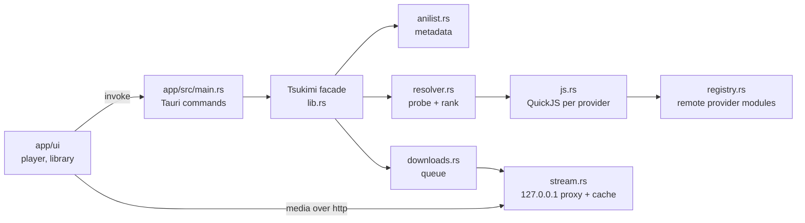

# Tsukimi: architecture

How Tsukimi finds, plays and keeps anime, and where each piece lives. What it does for users is in the
[README](../README.md); the rules for working on the code (and the invariants that keep QuickJS stable) are in
[CLAUDE.md](../CLAUDE.md).

## Overview

A Cargo workspace:

| Part | Role |
|---|---|
| `crates/tsukimi-core` | All the logic, no UI dependency: metadata, the provider runtime, source resolution, the streaming proxy and cache, downloads, updates |
| `app/` | The Tauri 2 shell: commands that call `Tsukimi` methods, the window, self-install; `app/ui/` is plain HTML / CSS / JS with no build step |

## Providers

Streams come from the remote **dango provider registry** (`serifpersia/dango-providers`). Its modules are
JavaScript and run **unmodified** in an embedded QuickJS engine:

- `registry.rs` parses the registry, downloads each module and checks its SHA-256, caches them on disk and falls
  back to the cache when offline. Only `kind: "anime"` entries are loaded.
- `js.rs` gives every provider its own QuickJS runtime. Network, timers, caching, crypto, URL parsing and AniList
  are implemented in Rust and exposed through a `__host` object; `js/prelude.js` builds the Node-like environment
  (`fetch`, `URL`, timers, `Buffer`, cheerio…) and the `ctx` API the modules expect.
- **Providers are untrusted code.** They can only reach public `http(s)` addresses: requests to `localhost`, the
  home network, link-local and CGNAT ranges are refused (`http.rs`), and so are redirects to them and names that
  resolve to them.
- All QuickJS work runs on one dedicated thread, one call at a time per provider; network work runs on the app's
  runtime. (Letting runtimes hop threads corrupted the heap; see CLAUDE.md.)

## From a search to playback

1. **Search** queries AniList (`anilist.rs`: rate limited, coalesced, cached in memory and SQLite). The top
   results are pre-probed in the background.
2. **Probe** (`resolver.rs`) asks every provider in parallel for the show's id and episode list (`isDirectId`, else
   `resolveShowId`, else search and title matching). Show ids are cached for 7 days, episode lists for 30 minutes.
   The UI sees each provider's progress live.
3. **Verify** fetches the first episode's playlist (HLS) or first kilobyte (MP4) from each working provider.
4. **Rank**: working, then verified, then episode coverage against AniList, then tier, soft subtitles and latency,
   with a bonus for the preferred provider.
5. **Streams** become local URLs, `http://127.0.0.1:{port}/s/{token}/{hls|file|sub|img|seg}/{spec}`, served by
   `stream.rs`.
6. **The stream server** rewrites playlists so every segment comes back through it, downloads segments ahead of
   the playhead into a content-addressed disk cache, serves MP4 ranges from a growing `.part` file, converts
   subtitles to WebVTT, and only accepts its random token and public upstream addresses.
7. **Failover** in the player: next quality, next stream, the same provider with fresh links, then the next
   provider, keeping the position.

## Downloads (`downloads.rs`)

Every downloaded or queued episode is a row in SQLite with its **saved source**: the media playlist as fetched and
its subtitles. Playback of a download re-serves that saved playlist locally, so it keeps working after the
provider's links expire. One worker handles the queue; failed pinned downloads retry on a back-off (1 min up to
3 h) and at every start. When a pinned download completes, its files move from `cache/` to `downloads/`, which the
cache cleanup (`janitor.rs`: age expiry and LRU eviction) never touches.

## Storage

`store.rs` keeps the library, watch progress, settings, downloads and a TTL key/value cache in one SQLite
database. Everything (database, logs, cache, downloads, the webview's data) lives in the install folder's `data/`;
`TSUKIMI_DATA_DIR` overrides it. `migrate.rs` carries data over from the app's previous name, dango.

## Updates and releases

`updater.rs` checks GitHub 20 s after start and every 6 h, verifies downloads against `SHA256SUMS.txt`, then runs
the Windows setup silently or swaps the program on Linux / macOS and relaunches. A release has exactly three
programs (`Tsukimi-setup.exe`, `tsukimi-linux-x64`, `tsukimi-macos-arm64`); the same file installs and updates.
Versions continue from dango's 4.x because the registry's `minDango` compares against them.
